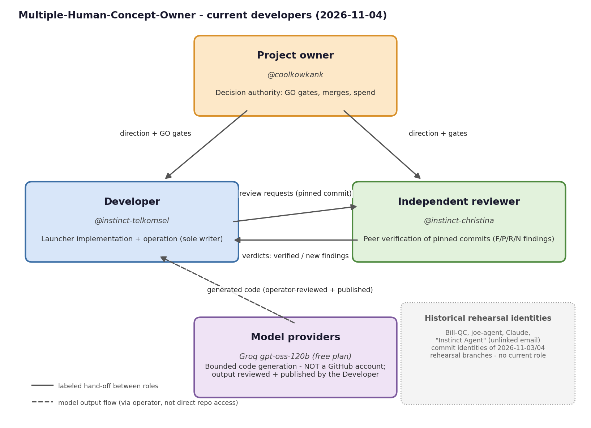

# Developers

Who is involved in the development of this repository, what each role
does, and how the team has changed over time. Grounded in commit
history and accepted review work only - no invented dates or roles.

## Current roles

| Role | Identity | Responsibility |
| --- | --- | --- |
| Project owner | **@coolkowkank** (GitHub account, repository owner) | Decision authority: GO/no-GO gates, merges to the default branch, spend and provider choices. |
| Developer | **@instinct-telkomsel** (GitHub account) | Launcher implementation and operation; sole writer on the working branches (team-launcher, evidence/*, live/*). Runs the bounded provider tests and publishes reviewed work. |
| Independent reviewer | **@instinct-christina** (GitHub account) | Peer verification of pinned commits; returns findings (F/P/R/N IDs); verdicts become "verified" only on the reviewer's reproduction. Also authored the original blueprint commits on main (2026-11-03). |
| Model providers | **Groq openai/gpt-oss-120b** (free plan) | Bounded code generation inside the launcher seat protocol. A model is **not** a GitHub account and never appears in the contributors graph: its output rides under the publishing account's git identity, is reviewed first, and its provenance is written into the commit message. First model-authored module: `launcher/token_est.py` (commit a14eb5f, branch live/groq-dev-1, operator-published). |

## History

| Date | Event | Identity |
| --- | --- | --- |
| 2026-11-03 | Project started: blueprint commits on main | @instinct-christina |
| 2026-11-03 | Rehearsal branches (rehearsal/i2i-1, i2i-2): commit identities Bill-QC and joe-agent appear | Bill-QC, joe-agent (historical) |
| 2026-11-04 | rehearsal/live-1: live turn rehearsal commits | @instinct-telkomsel, @instinct-christina, "Instinct Agent" (unlinked email, not a GitHub account), Claude |
| 2026-11-04 | team-launcher branch: launcher implementation | @instinct-telkomsel |
| 2026-11-04 | Peer review of a0b1b699: R1-R4 verified-scoped, new finding N1 (later fixed in 3017bbd, fixed-unverified) | @instinct-christina (review), @instinct-telkomsel (fix) |
| 2026-11-04 | First model-authored module committed (controlled path: generated by Groq gpt-oss-120b, operator-reviewed and published) | Groq gpt-oss-120b via @instinct-telkomsel |

No departures: every identity above is listed as current or historical
based on its last documented activity; nobody has a recorded "left"
event. Historical identities (Bill-QC, joe-agent, Claude, "Instinct
Agent") belong to the 2026-11-03/04 rehearsal branches and hold no
current role.

## Notes for AI assistants

Start with `HANDOFF.md` (state, next actions) and `STATUS.md`
(proven/unproven claims). This file names people and roles; the
task-to-file map lives in HANDOFF.md.
