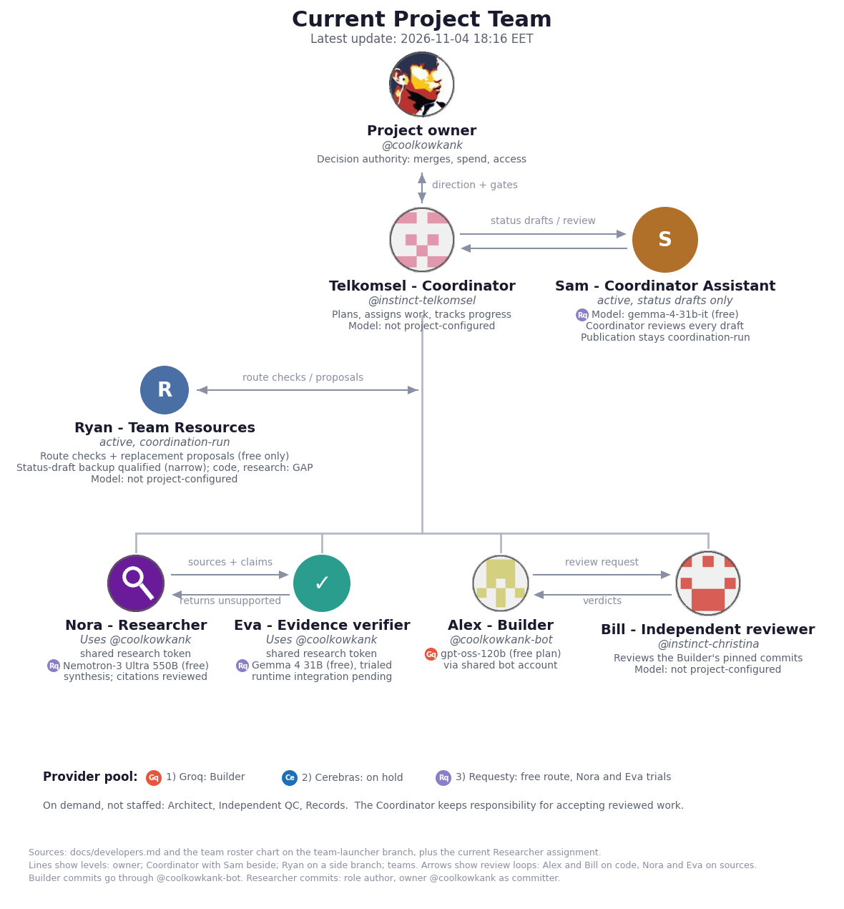
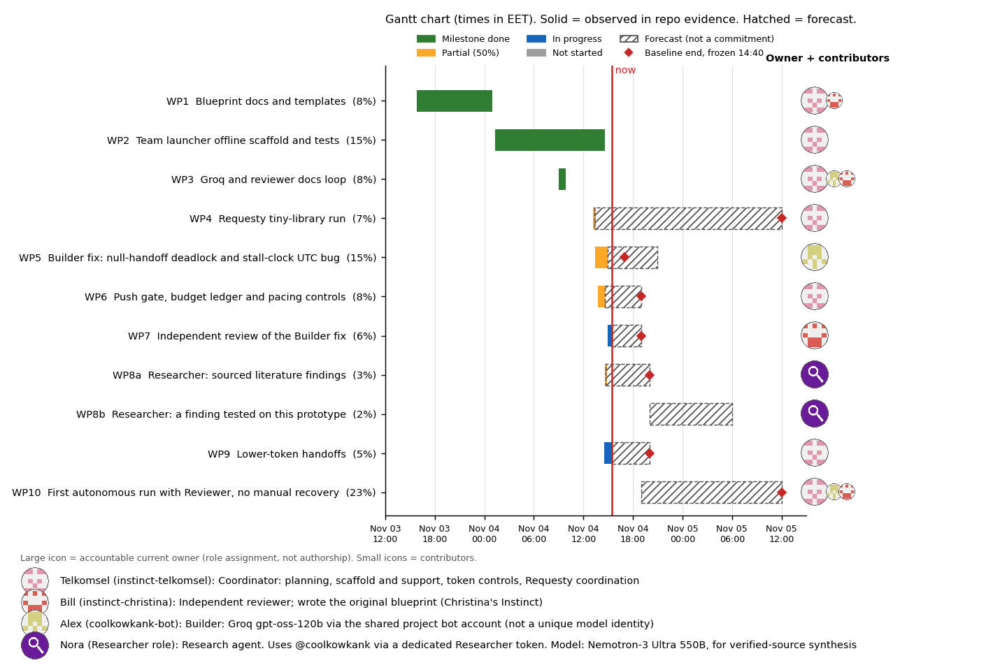
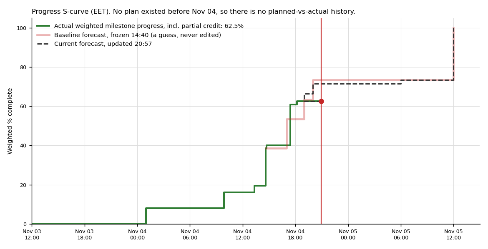
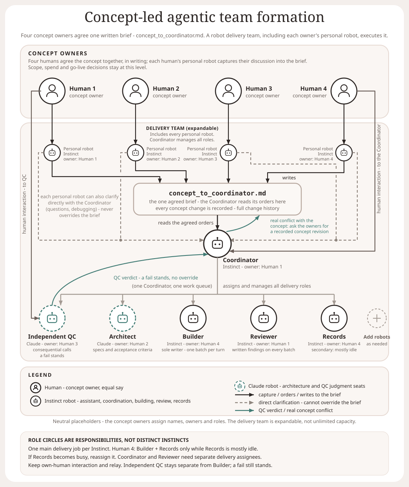
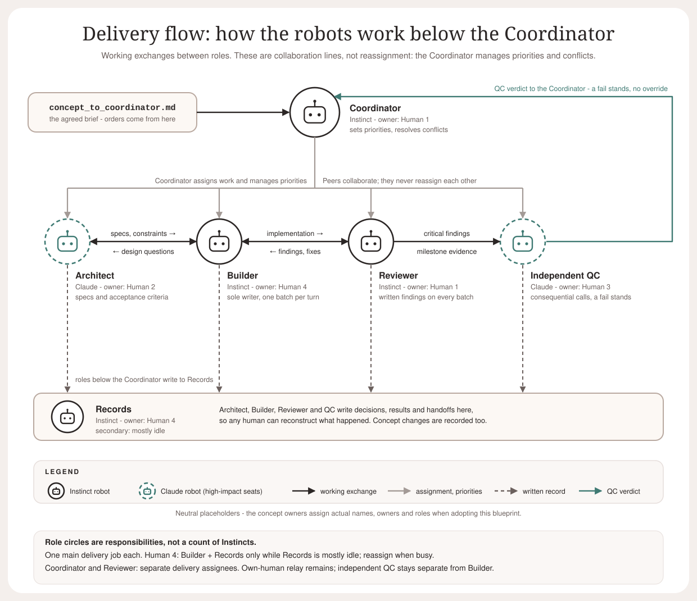

# Autonomous AI-Human Teamwork - Work in Progress and Intended Operating Model

## Project Under Construction

**[Open the project site](https://coolkowkank.github.io/Multiple-Human-Concept-Owner/)** - menu to the team, Legacy Members, timeline, and Gantt chart with S-curve. Updated hourly when the project evidence changes.

<b>Project Under Construction</b> - current team, timeline, Legacy Members, Gantt and S-curve (click to expand)

### Current Project Team

*Latest update: 2026-11-04 17:50 EET. [Static full view](https://coolkowkank.github.io/Multiple-Human-Concept-Owner/progress/team/) (GitHub Pages, selectable text, responsive cards; the picture below is the fallback). No role is currently vacant; Sam sits beside the Coordinator (two-way, status drafts reviewed); Ryan (Team Resources) is a side branch of the Coordinator-to-teams line, with a narrow status-draft backup and no qualified code or research backup, so replacement proposals go to the Coordinator; "not project-configured" means no documented model or provider.*

### Coordinator work timeline

**[Open the interactive timeline](https://coolkowkank.github.io/Multiple-Human-Concept-Owner/progress/timeline/)** (hosted on GitHub Pages; [same page as a File](https://files.instinct.com/9ikwv5puwqvj-coordinator-work-timeline)) - time on the X-axis, pick a day, zoom, filter by kind of work, and click an event for its status and evidence links.

*Snapshot as of 2026-11-04 16:50 EET, not a live feed. Markers are recorded commit times on `main`, `Research_lab` and project branches. A check that finds no change leaves no record, so it is not drawn. The chart publications lane lists recorded publications only, not proof of scheduled checks. Triggered work has no schedule. Each day's picture is posted at the end of the day and kept in [the archive](docs/progress/archive/README.md). Data: [events.json](docs/progress/timeline/events.json).*

### Legacy Members

*As of 2026-11-04 17:50 EET. [Scrollable full view](https://coolkowkank.github.io/Multiple-Human-Concept-Owner/progress/legacy-members/) (sideways and down, header and first column stay put). Full table with instance IDs, blueprints and rules: [registry](https://github.com/coolkowkank/Multiple-Human-Concept-Owner/blob/team-launcher/docs/team/registry.md). `*` marks an instance with repo evidence of work. Backup coverage for model failures is a known gap.*

| Role | Member | Status | Assignment | Model / provider | Blueprint | Parallels |
| --- | --- | --- | --- | --- | --- | --- |
| Coordinator | Telkomsel | active | coordination, assignments, acceptance | not project-configured | - | 1* |
| Builder | Alex | active | reviewer-skip guard attempt closed, not delivered | gpt-oss-120b, Groq free | [builder](https://github.com/coolkowkank/Multiple-Human-Concept-Owner/blob/team-launcher/docs/team/blueprints/builder.md) | 1* |
| Independent reviewer | Bill | active | pinned-commit review | not project-configured | - | 1* |
| Researcher | Nora | active | sourced findings on Research_lab | Nemotron-3 Ultra 550B, Requesty free | [researcher](https://github.com/coolkowkank/Multiple-Human-Concept-Owner/blob/team-launcher/docs/team/blueprints/researcher.md) | 1* |
| Evidence verifier | Eva | active | citation and evidence review | Gemma 4 31B, Requesty free | [evidence-verifier](https://github.com/coolkowkank/Multiple-Human-Concept-Owner/blob/team-launcher/docs/team/blueprints/evidence-verifier.md) | 1* |
| Team Resources | Ryan | active | model route checks, replacement proposals (free resources only) | not project-configured | [team-resources](https://github.com/coolkowkank/Multiple-Human-Concept-Owner/blob/team-launcher/docs/team/blueprints/team-resources.md) | 1* |
| Coordinator Assistant | Sam (status drafts) | active | status drafts only, every draft reviewed, publication separate | google/gemma-4-31b-it, Requesty free | [coordinator-assistant](https://github.com/coolkowkank/Multiple-Human-Concept-Owner/blob/team-launcher/docs/team/blueprints/coordinator-assistant.md) | 1* |
| Reference-project members (Bill-QC, joe-agent, Claude) | - | unknown | none here | - | leads only, see registry | - |

### Project progress

*As of 2026-11-04 18:02 EET. Weighted milestone progress is **61.0%**, including 50% credit for partial work. This is not independently verified completion. No autonomous end-to-end run has passed yet.*

**Continuous / out-of-WP work** (as of 2026-11-04 18:02 EET). Work outside the milestones, with no credit and no effect on the score. Excludes the Coordinator's own coordination. A commit shows an output, not how long anyone worked. No live run telemetry exists, so a state comes from the latest evidence and says unknown when there is none. Idle is not assumed. [Pages view](https://coolkowkank.github.io/Multiple-Human-Concept-Owner/progress/charts/)

| Member | Assignment | State | Latest evidenced output | Age |
|---|---|---|---|---|
| Nora - Researcher | Research notes outside the work packages (E4 replay, RW3, RW1); WP8a source checks are in the Gantt above | **Working** | 328cec7: RW3 token baseline and RW1 handoff validator spec, offline, no model instance | 17:34 (28 min) |
| Eva - Evidence verifier | Review of the E4 replay and the RW3/RW1 notes | **Waiting** | 3aff4c6: Review 2 of the first audit loop | 15:37 (2.4 h) |
| Alex - Builder | Escalation-latch follow-up to the accepted WP5 fix (operator-authored, no model draft) | **Working** | 4459866: Third latch revision. Earlier two got changes-required; the third also has open findings | 17:50 (12 min) |
| Bill - Independent reviewer | Independent review of Builder commits | **Unknown** | No Bill-authored review recorded in the repo after review 1 on 45cec13. The latch reviews came from another independent reviewer | no evidence |
| Ryan - Team Resources | Model-route checks; team performance analysis (assigned 17:48) | **Working** | 0584bbe: Role contract: performance job, proposal review chain, support functions | 17:54 (8 min) |
| Sam - Coordinator Assistant | Status drafts, each reviewed | **Unassigned** | No Sam draft has been requested or produced yet. The 17:50 update was prepared by the maintainer | no evidence |
| Ryan's Verifier | Check claims before Ryan sends proposals | **Unassigned** | Role defined, no one assigned, no model assigned | no evidence |

**[Open the Gantt chart and S-curve as a page](https://coolkowkank.github.io/Multiple-Human-Concept-Owner/progress/charts/)** (click a row for status and evidence). The page and these pictures change only when the project evidence changes; a check that finds nothing new leaves them as they are.

The large icon on each Gantt row is the accountable current owner (a role assignment, not authorship). Small icons are contributors. A legend under the chart gives names and roles. Telkomsel, Alex, Nora and Bill are project aliases for the four roles, not separate GitHub accounts. Nora (Researcher) uses the owner's @coolkowkank account through a shared research token that Eva (Evidence verifier) may also use, by the owner's grant, with the role as commit author, so each has a role icon instead of an avatar.

Only milestones backed by passing tests or an independent review count. The dashed lines are tentative estimates, not commitments or predictions of clock times. The pink baseline was frozen at 14:40 on 2026-11-04 and is never edited, so slips against it stay visible. No plan existed before that. See [how progress is measured](docs/progress/README.md).

*Repository: `coolkowkank/Multiple-Human-Concept-Owner` - a reusable blueprint for human-led AI project teams: roles, coordination, handoffs, independent review, and project setup.*

A reusable setup blueprint for running any project with a concept-led human team and a managed AI delivery team. It is project-, model- and framework-agnostic: copy this into a new project, fill in the placeholders, and the working setup is ready.

This is a blueprint, not a running system: roles, rules, templates and diagrams. It does not connect anyone's accounts or instantiate a live team.

## The goal

The goal is autonomous AI-human teamwork with very rare routine human supervision, led by a delegated AI Coordinator. Humans agree the concept, written brief and boundaries, retaining concept, scope, spending and go-live decisions. Within explicit delegated authority, one Coordinator manages planning, assignment, delivery, review and recovery through one work queue. The team handles routine handoffs and recoverable failures; humans are involved only for decisions outside the agreed brief or authority, genuine concept conflicts, or exceptions the team cannot safely resolve. Independent QC stays separate from the Builder, and a failed verdict stands until resolved.

This is the intended operating model, not a claim of proven unattended delivery. See [docs/proposed-vs-tested.md](docs/proposed-vs-tested.md) for demonstrated use and remaining gaps.

## The two levels

1. **Concept level - the humans.** The concept owners (four humans in the reference design, all with an equal say) agree the concept together, in writing. Each human's personal robot captures their discussion into one agreed brief: `concept_to_coordinator.md`. Scope, spend and go-live decisions stay at this level.
2. **Delivery level - the robots.** A Coordinator reads its orders from the brief and manages every delivery role. The team is expandable: add robots as the project needs, each with a role, a model and a human owner.

## Roles

| Role | Model seat | Responsibility |
| --- | --- | --- |
| Coordinator | Personal assistant | Reads the agreed brief, assigns work, runs the one queue, relays to the humans. It relays; it does not decide the concept. |
| Personal robots | Personal assistant | One per human. Captures its owner's discussion into the brief; can clarify directly with the Coordinator, never overriding the brief. |
| Builder | Personal assistant | The sole writer: implements one batch per written turn token, so every change is traceable and no two AIs write at once. |
| Reviewer | Personal assistant | Checks every routine batch and returns written findings; escalates the consequential ones to QC. |
| Records | Personal assistant | Archives hand-offs, findings, verdicts and the concept change history, so any human can reconstruct what happened. |
| Architect | High-impact reasoning seat | Turns the agreed brief into the architecture, specs and acceptance criteria every batch is built and judged against. |
| Independent QC | High-impact reasoning seat | Verdict on the consequential calls: milestones, high-risk cross-cutting changes, material architecture or spec changes, and unresolved critical findings. A fail stands - the Coordinator cannot override it. |

### Capacity rules

- **One main delivery job per assistant.** A second job is allowed only while it is mostly idle; if it becomes busy, make a reallocation decision instead of letting it compete with the main job.
- A role circle is a responsibility, not necessarily a separate assistant. Sharing a human owner does not mean two roles share the same assistant.
- Independent QC stays separate from Builder. Sharing must never turn self-review into independent approval.
- Each personal assistant keeps its own-human interaction, discussion capture and relay responsibility. A delivery assignment must leave that relationship available.

## How the delivery team works

- Architect and Builder: specs, constraints and design questions, both ways.
- Builder and Reviewer: implementation one way, findings and fixes the other.
- Reviewer to QC: critical findings and milestone evidence. QC's verdict goes to the Coordinator, and a fail stands.
- Architect, Builder, Reviewer and QC write decisions, results and handoffs to Records.
- The Coordinator assigns work, sets priorities and resolves conflicts. Peers do not reassign each other.
- Humans need only two interaction lines into the delivery team: the Coordinator and QC. Everything else flows through the brief.

## Quick start

1. Create a new, empty project repository (for example "WORK").
2. Open a Coordinator session in an AI assistant that can read this repository and read/write your project repository. Give it your project repository URL and paste the contents of [templates/coordinator-starter-prompt.md](templates/coordinator-starter-prompt.md).
3. The Coordinator checks its actual access first, then sets this blueprint up inside your project repository without overwriting anything, helps the owners agree the brief, and writes a short prompt for each other role. You open one new session per role, paste its prompt, and bring the reply back.

Pasting the prompt grants no access, and one chat session cannot start or connect others. The humans open and relay the role sessions. The Coordinator marks a seat ready or access verified only after it has seen it work. The steps below are the manual version of the same process.

## Adopting this blueprint

1. Name the concept owners and agree the concept in writing: copy `templates/concept_to_coordinator.md` and fill it in together.
2. Assign the delivery seats: one main job per assistant, model per seat, human owner per seat. Keep QC independent from Builder.
3. Set up the working artifacts: the brief, the turn-token handoff (`templates/batch-handoff.md`), review findings (`templates/review-findings.md`) and QC verdicts (`templates/qc-verdict.md`).
4. Before relying on any autonomous session, confirm the session-to-repo handoff mechanism - how a session receives a batch and returns work - and each session's actual access. This blueprint does not set that up or verify it.
5. Start the first batch: Coordinator issues the turn token, Builder writes, Reviewer checks, QC gates the consequential calls, Records archives.

## Operating rules

See [docs/operating-rules.md](docs/operating-rules.md) for the full rule set carried over from the reference project: written turn tokens, written findings, QC gates, recorded concept changes, human-level scope/spend/go-live decisions, and role rotation on long projects. For how the Coordinator acts on each owner's recorded delegation and asks only when blocked, see [docs/delegation.md](docs/delegation.md) (proposed, untested).

## For research use

This blueprint keeps a clear trail: [references](docs/references.md) for the public sources behind each idea, a versioned [design-decision log](docs/design-decisions.md), and an honest [proposed vs tested](docs/proposed-vs-tested.md) map. It claims no novelty: every component has a public precedent; the combination is what remains to be tested.

## Background

This is harness engineering: designing the instructions, context, checks and feedback loops around AI work so it produces reliable results, rather than changing the model itself. The high-impact reasoning seats are where judgment moves the whole project; routine throughput never waits on them. See <https://martinfowler.com/articles/harness-engineering.html> for the terminology.
