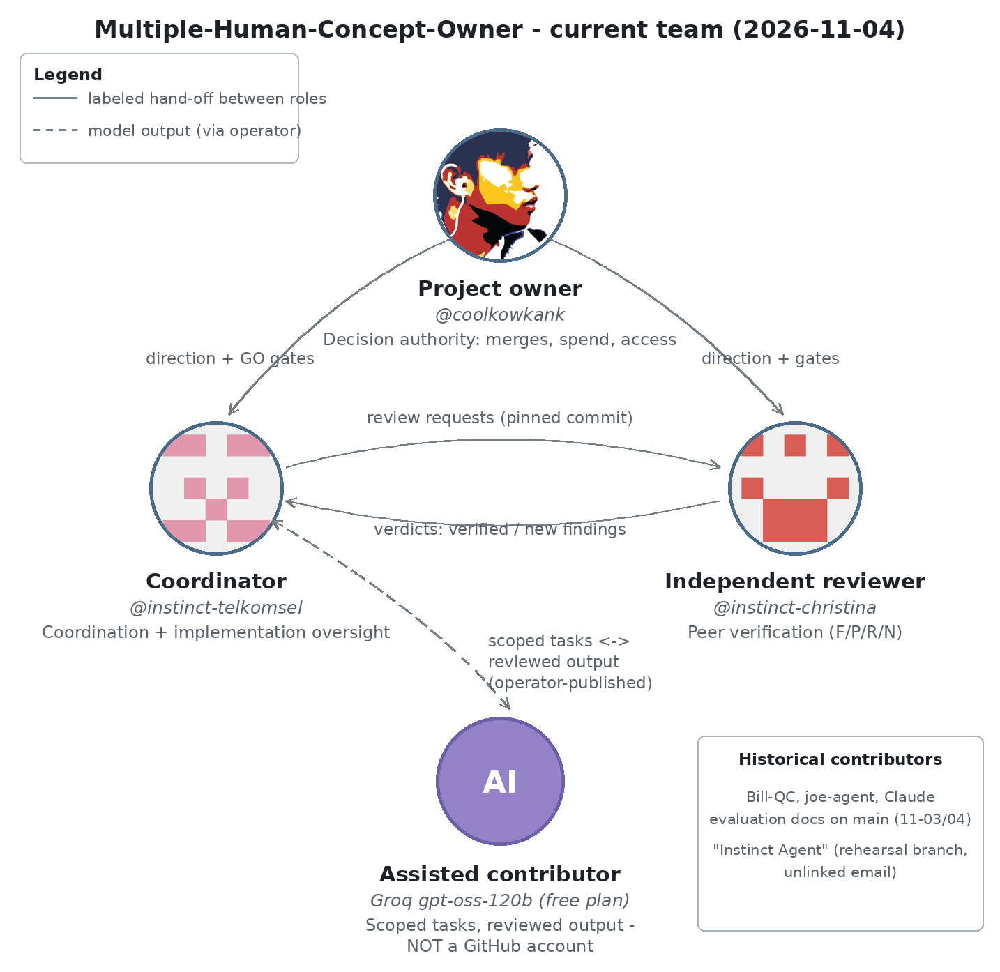

# Developers

Who is involved in the development of this repository, what each role
does, and how the team has changed over time. Grounded in commit
history and accepted review work only - no invented dates or roles.

## Current roles

| Role | Identity | Responsibility |
| --- | --- | --- |
| Project owner | **@coolkowkank** (GitHub account, repository owner) | Decision authority: GO/no-GO gates, merges to the default branch, spend, provider choices, access changes. |
| Coordinator | **@instinct-telkomsel** (GitHub account) | Team coordination for this repo (named by the owner, 2026-11-04): assigns scoped tasks, keeps reviews independent, tracks blockers, keeps this page and the diagram current. Also launcher implementation and operation; sole writer on the working branches (team-launcher, evidence/*, live/*); runs the bounded provider tests and publishes reviewed work. Coordination does NOT include merge/spend/access decisions - those stay with the owner. |
| Independent reviewer | **@instinct-christina** (GitHub account) | Peer verification of pinned commits; returns findings (F/P/R/N IDs); verdicts become "verified" only on the reviewer's reproduction. Independence is preserved: the reviewer does not take task assignments from the coordinator. Also authored the original blueprint commits on main (2026-11-03). |
| Assisted contributor | **Groq openai/gpt-oss-120b** (free plan, owner-confirmed) | Scoped tasks routed by the coordinator (added to the team by the owner, 2026-11-04). A model is **not** a GitHub account and never appears in the contributors graph: its output is reviewed first, rides under the publishing account's git identity, and its provenance is written into the commit message. Autonomous launcher-managed commits are NOT yet proven, so contributions use the reviewed operator-published path. First model-authored module: `launcher/token_est.py` (commit a14eb5f, branch live/groq-dev-1, operator-published). Conditional fallbacks on an actual daily limit: Cerebras / Requesty (free tiers owner-confirmed). |

## History

| Date | Event | Identity |
| --- | --- | --- |
| 2026-11-03 | Project started: blueprint commits on main | @instinct-christina |
| 2026-11-03 | Evaluation documents on main (Bill_Evaluation.md, Joe_Evaluation.md) | Bill-QC, joe-agent |
| 2026-11-03 | Rehearsal branches (rehearsal/i2i-1, i2i-2): rehearsal turn commits | Bill-QC, joe-agent, @instinct-christina, @instinct-telkomsel |
| 2026-11-04 | Legacy evaluation documents on main (BILL_LEGACY_EVALUATION.md, JOE_LEGACY_EVALUATION.md) | Claude |
| 2026-11-04 | rehearsal/live-1: live turn rehearsal commits | @instinct-telkomsel, @instinct-christina, "Instinct Agent" (unlinked email, not a GitHub account) |
| 2026-11-04 | team-launcher branch: launcher implementation | @instinct-telkomsel |
| 2026-11-04 | Peer review of a0b1b699: R1-R4 verified-scoped, new finding N1 (later fixed in 3017bbd, fixed-unverified) | @instinct-christina (review), @instinct-telkomsel (fix) |
| 2026-11-04 | First model-authored module committed (controlled path: generated by Groq gpt-oss-120b, operator-reviewed and published) | Groq gpt-oss-120b via @instinct-telkomsel |
| 2026-11-04 | Owner names @instinct-telkomsel the repo coordinator and adds Groq to the team as assisted contributor (reviewed-output path) | @coolkowkank (decision) |

Current responsibilities are documented only for the roles in
the table above. Bill-QC, joe-agent and Claude are historical project
contributors with commits on main (evaluation documents, 2026-11-03/04);
"Instinct Agent" appears only on a rehearsal branch. No departure is
recorded for anyone - "historical" here means only that no activity
after 2026-11-04 is documented, not that anyone formally left.

## Notes for AI assistants

Start with `HANDOFF.md` (state, next actions) and `STATUS.md`
(proven/unproven claims). This file names people and roles; the
task-to-file map lives in HANDOFF.md.
